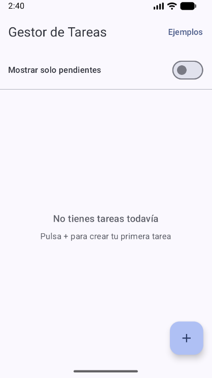
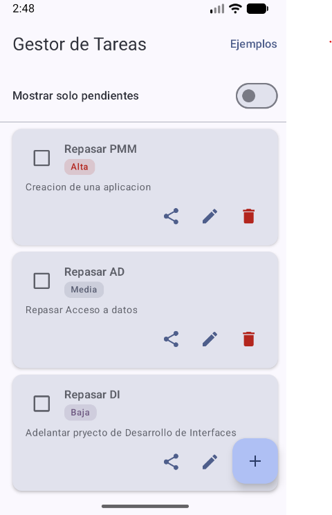
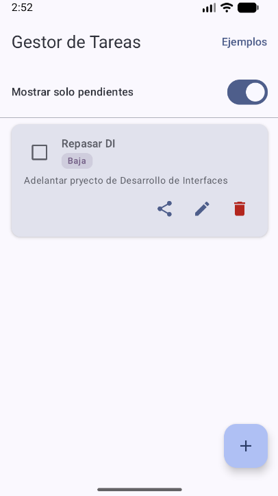
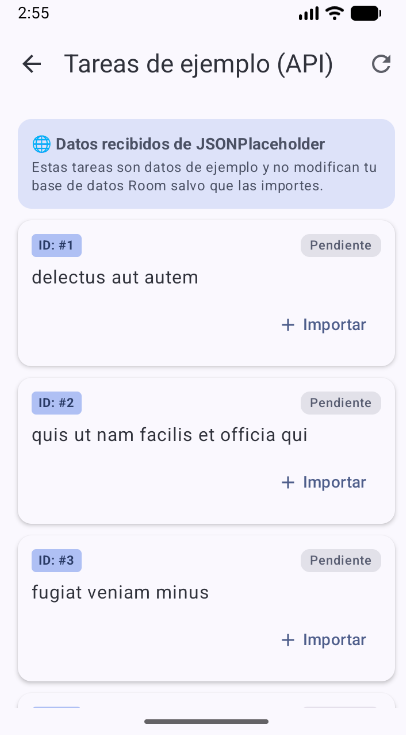

# GestorPersonalTareas

Aplicación Android nativa desarrollada en **Kotlin** y **Jetpack Compose** para la gestión personal de tareas locales, persistencia de preferencias de usuario y consulta de tareas de ejemplo desde una API REST pública.

## Enlace a la conversación con la IA

- **Registro de consultas durante el desarrollo:** [Ver conversación con la IA](https://gemini.google.com/share/d/1TW9TgOTI8cc4m_zJeSajSeTwCsN-26ma?usp=sharing)

## Funcionalidades principales

- **Gestión completa de tareas (CRUD):** Creación, edición, marcado como completada y eliminación (con diálogo de confirmación) almacenadas de forma persistente en base de datos local.
- **Validación de formulario:** Control de campos obligatorios (título mínimo de 3 caracteres reales ignorando espacios en blanco) y prevención de doble envío al guardar.
- **Niveles de prioridad:** Clasificación visual por prioridad (**Alta**, **Media** y **Baja**).
- **Filtro persistente:** Interruptor *«Mostrar solo pendientes»* que filtra el listado y conserva su estado tras cerrar completamente la aplicación.
- **Consulta de API externa:** Descarga de tareas de ejemplo desde `JSONPlaceholder` con indicador de carga, gestión controlada de errores de red sin cierre inesperado y opción de importar tareas a la base de datos local.
- **Compartir tareas:** Envío del título, descripción y prioridad de una tarea hacia aplicaciones externas mediante el selector nativo de Android.

## Tecnologías y arquitectura

- **Lenguaje:** Kotlin
- **Interfaz de usuario:** Jetpack Compose con componentes de Material Design 3 y navegación basada en estados (sin `NavHost` ni Hilt).
- **Arquitectura:** Patrón **MVVM** (`TareasViewModel`, corrutinas con `viewModelScope` y estados observables en Compose).
- **Base de datos local:** **Room** (`TareaEntity`, `TareaDao`, `AppDatabase`).
- **Preferencias de usuario:** **Preferences DataStore** (`UserPreferencesRepository`) para almacenar el estado del filtro.
- **Consumo de red:** **Retrofit 2** + conversor **Gson** (`JsonPlaceholderApi`, `RetrofitClient`, `TodoDto`) sobre el endpoint `https://jsonplaceholder.typicode.com/todos`.
- **Comunicación entre apps:** `Intent.ACTION_SEND` con `Intent.createChooser`.

## Estructura del proyecto

```text
GestorPersonalTareas/
├── app/
│   └── src/main/java/com/example/gestorpersonaltareas/
│       ├── data/
│       │   ├── local/           # Base de datos Room (AppDatabase, TareaDao, TareaEntity)
│       │   ├── preferences/     # Persistencia del filtro con DataStore (UserPreferencesRepository)
│       │   └── remote/          # Cliente Retrofit y modelos de API (JsonPlaceholderApi, RetrofitClient, TodoDto)
│       ├── model/               # Modelo de dominio (Tarea)
│       ├── ui/
│       │   ├── screens/         # Pantallas en Compose (PantallaListaTareas, PantallaFormularioTarea, PantallaTareasEjemplo)
│       │   ├── theme/           # Tema, colores y tipografía Material 3
│       │   └── TareasViewModel.kt
│       └── MainActivity.kt
├── screenshots/                 # Capturas de pantalla de la aplicación en ejecución
├── app-debug.apk                # Instalable compilado listo para probar en dispositivo o emulador
└── README.md                    # Documentación del proyecto y enlace a la conversación con la IA
```

## Capturas de pantalla

| Estado inicial vacío | Listado de tareas y prioridades |
| :---: | :---: |
|  |  |

| Filtro «Mostrar solo pendientes» | Tareas de ejemplo desde API (Retrofit) |
| :---: | :---: |
|  |  |
